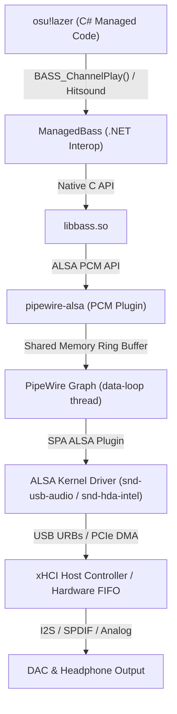

# Linux Rhythm Game Audio Architecture & Timing Breakdown

This document provides a technical deep-dive into how audio flows from **osu!lazer** to your ears on modern Linux systems (PipeWire, WirePlumber, ALSA, and the kernel), explaining where latency originates and how each optimization works.

---

## The Signal Chain

---

## Latency Components: Where Does Delay Live?

When you click a circle and expect to hear a hitsound, the sound must traverse multiple buffers before reaching your headphones:

| Stage | Mechanism | Delay at 44.1kHz | Configurable? |
|---|---|---|---|
| **1. Game & BASS Queue** | Sample decoding & BASS mixer buffer | ~0.5ms – 2.0ms | Yes (`PIPEWIRE_ALSA buffer-bytes=1024`) |
| **2. PipeWire Graph** | Quantum DSP processing slice | **0.725ms** (Quantum 32) | Yes (`PIPEWIRE_LATENCY="32/44100"`) |
| **3. ALSA Ring Buffer** | Hardware driver ring buffer (`delay`) | **~2.1ms** (Period 64 + Headroom 32) | Yes (via WirePlumber `api.alsa.*`) |
| **4. USB Controller & Driver FIFO** | xHCI USB Request Block (URB) transmission | **~8.0ms** (USB 2.0 frames) | Hardware/kernel dependent |
| **5. DAC Interpolation / Output** | Sigma-Delta anti-aliasing DAC filter | ~0.1ms – 0.5ms | Fixed by hardware |
| **Total Physical Latency** | **Click to Ear** | **~10.5ms – 11.5ms** | **Rock-solid & Jitter-free** |

---

## The 4 Traps of Linux Rhythm Game Audio

### Trap 1: The Pro Audio Profile Fixed-Quantum Lock
- **The Symptom:** If you launch osu! first, sound is clean. If Discord or a browser is open first, osu! crackles violently.
- **The Cause:** When WirePlumber detects an audio interface with a "Pro Audio" profile, it defaults to `api.alsa.disable-tsched = true` (Hardware IRQ mode). In this mode, the hardware period is locked at device initialization time to the request of the *first* application. If Discord opens it at 1024 frames, osu! cannot shrink the hardware buffer to 64 or 32, causing constant ALSA underruns (xruns).
- **The Fix:** Force `api.alsa.disable-tsched = false` (timer-based scheduling) so PipeWire dynamically resizes the quantum slice.

---

### Trap 2: Hardware Ring Buffer Bloat
- **The Symptom:** PipeWire shows quantum 32 (~0.7ms) in `pw-top`, but hitsounds feel significantly delayed and your universal offset in osu! drifts by 20ms+ between sessions.
- **The Cause:** In timer mode (`tsched`), PipeWire dynamically changes the software quantum, but **does not reopen ALSA `hw_params`**. If Discord opened the DAC first with a 512 period and 512 headroom, ALSA's physical ring buffer (`/proc/asound/cardX/pcm0p/sub0/status`) stays at ~1150 samples (**~26ms** of hidden physical delay).
- **The Fix:** Lock `api.alsa.period-size = 64` and `api.alsa.headroom = 32` in WirePlumber. The physical ring buffer is permanently held at ~2ms regardless of which app opens first.

---

### Trap 3: Clock Master Inversion
- **The Symptom:** Random audio pops or micro-pitch warping when using a USB microphone.
- **The Cause:** USB devices run on independent hardware crystal oscillators. If your USB microphone (e.g. Fifine, Blue Yeti) has a higher `priority.driver` (e.g. 2600) than your DAC (e.g. 1600), PipeWire makes the microphone the clock master. The DAC is forced to continuously adjust its playback rate (adaptive resampling) to follow the microphone's clock.
- **The Fix:** Assign your audio output DAC `priority.driver = 3000` and demote microphones to `1000`.

---

### Trap 4: The .NET Garbage Collection Priority Inversion Deadlock
- **The Symptom:** osu! runs smoothly for a few songs, then completely freezes or silently terminates when returning to the Song Select carousel.
- **The Cause:** osu!lazer is built on .NET 10 CLR. Managed garbage collection performs Stop-The-World pauses where background GC threads signal all managed threads to suspend. If you boost osu!'s `Update (GameThread)` to Realtime (`SCHED_FIFO 70`), it starves the background GC threads (which run in `SCHED_OTHER 0`). The GC cannot finish the safepoint, creating an unrecoverable priority-inversion deadlock.
- **The Rule:**
  - **SAFE to boost to `SCHED_FIFO`:** Pure native C audio threads (`Audio*`, `alsa-pipewire`).
  - **NEVER boost to `SCHED_FIFO`:** Managed game logic threads (`Update`, `Draw`).
