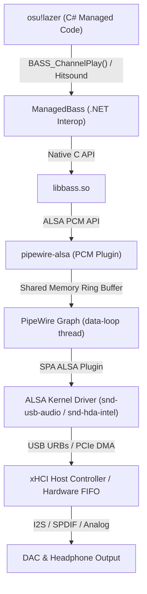

# Linux Rhythm Game Audio Architecture & Timing Breakdown

This document provides a technical deep-dive into how audio flows from **osu!lazer** to your ears on modern Linux systems (PipeWire, WirePlumber, ALSA, and the kernel), explaining where latency originates and how each optimization works.

---

## The Signal Chain

---

## Latency Components: Where Does Delay Live?

When you click a circle and expect to hear a hitsound, the sound must traverse multiple buffers before reaching your headphones:

| Stage | Mechanism | Delay at 44.1kHz | Configurable? |
|---|---|---|---|
| **1. Game & BASS Queue** | Sample decoding & `pipewire-alsa` ring buffer | **~0.7ms – 1.45ms** (32 period / 64 buffer) | Yes (`alsa.buffer-bytes=512 alsa.period-bytes=256`) |
| **2. PipeWire Graph** | Quantum DSP processing slice | **0.725ms** (Quantum 32) | Yes (`clock.force-quantum 32` & `PIPEWIRE_LATENCY="32/44100"`) |
| **3. ALSA Ring Buffer (`appl - hw`)** | Hardware driver ring buffer fill | **~0.61ms – 0.72ms** (27 – 32 samples) | Yes (`period-size = 32`, `headroom = 32`, `disable-batch = true`) |
| **4. USB Isochronous URB FIFO** | xHCI USB Request Block transmission (`delay`) | **~4.4ms** (~194 USB FIFO samples) | Minimized by `disable-batch = true` & dedicated CPU xHCI |
| **5. DAC Interpolation / Output** | Sigma-Delta anti-aliasing DAC filter | ~0.1ms – 0.5ms | Fixed by hardware |
| **Total Physical ALSA + USB Delay** | **`/proc/asound/cardX/pcm0p/sub0/status` (`delay`)** | **~5.12ms (226 samples)** | **Rock-solid & Jitter-free** |

---

## The 7 Traps of Linux Rhythm Game Audio & Input

### Trap 1: The Pro Audio Profile Fixed-Quantum Lock
- **The Symptom:** If you launch osu! first, sound is clean. If Discord or a browser is open first, osu! crackles violently.
- **The Cause:** When WirePlumber detects an audio interface with a "Pro Audio" profile, it defaults to `api.alsa.disable-tsched = true` (Hardware IRQ mode). In this mode, the hardware period is locked at device initialization time to the request of the *first* application. If Discord opens it at 1024 frames, osu! cannot shrink the hardware buffer to 64 or 32, causing constant ALSA underruns (xruns).
- **The Fix:** Force `api.alsa.disable-tsched = false` (timer-based scheduling) so PipeWire dynamically resizes the quantum slice.

---

### Trap 2: Hardware Ring Buffer Bloat
- **The Symptom:** PipeWire shows quantum 32 (~0.7ms) in `pw-top`, but hitsounds feel significantly delayed and your universal offset in osu! drifts by 20ms+ between sessions.
- **The Cause:** In timer mode (`tsched`), PipeWire dynamically changes the software quantum, but **does not reopen ALSA `hw_params`**. If Discord opened the DAC first with a 512 period and 512 headroom, ALSA's physical ring buffer (`/proc/asound/cardX/pcm0p/sub0/status`) stays at ~1220 samples (**~27.6ms** of hidden physical delay).
- **The Fix:** Lock `api.alsa.period-size = 32` and `api.alsa.headroom = 32` in WirePlumber.

---

### Trap 3: The `snd_usb_audio` `BATCH` Flag Multiplier
- **The Symptom:** Even after setting `api.alsa.period-size = 64` and `api.alsa.headroom = 32`, USB DACs still report ~480 samples (~10.9ms) of `delay` in `/proc/asound/cardX/pcm0p/sub0/status`.
- **The Cause:** The Linux `snd_usb_audio` kernel driver sets the `SNDRV_PCM_INFO_BATCH` flag on USB audio interfaces because transfers happen in USB Request Blocks (URBs). When PipeWire's SPA ALSA plugin sees the `BATCH` flag, it automatically **doubles** the effective `headroom` and minimum period margin.
- **The Fix:** Set `api.alsa.disable-batch = true` alongside `api.alsa.period-size = 32` in WirePlumber. Combined with `clock.force-quantum 32`, total physical ALSA+USB `delay` drops from **480 samples (~10.88ms)** down to **226 samples (~5.12ms)**, with only **27 samples (~0.61ms)** in the active ring buffer (`appl_ptr - hw_ptr`).

---

### Trap 4: The `pipewire-alsa` `period-bytes` Frame Math & `min-avail: 58` Floor
- **The Symptom:** You pass `PIPEWIRE_LATENCY="32/44100"`, yet `pw-cli info <osu_node_id>` reports ` node.latency = "58/44100"` and `api.alsa.Controls = { min-avail: 58 }`.
- **The Cause:** With `alsa.format=S32_LE` (4 bytes/sample) and `alsa.channels=2`, each stereo frame is **8 bytes**. Setting `alsa.period-bytes=64` requests an 8-frame period (`64 / 8 = 8`), which is smaller than the 32-frame PipeWire quantum. `pipewire-alsa` rejects the 8-frame period and falls back to an internal `min-avail: 58` (~1.31ms) floor, overriding `PIPEWIRE_LATENCY="32/44100"`.
- **The Fix:** Set `alsa.period-bytes=256` (`256 / 8 = 32` frames = 0.725ms, matching quantum 32 1:1) and `alsa.buffer-bytes=512` (`512 / 8 = 64` frames = 1.45ms).

---

### Trap 5: Clock Master Inversion (Microphones & DAC Input Nodes)
- **The Symptom:** Random audio pops or micro-pitch warping when using a USB microphone or full-duplex USB audio interface.
- **The Cause:** USB devices run on independent hardware crystal oscillators. If your USB microphone (e.g. Fifine, Blue Yeti) has a higher `priority.driver` than your DAC—or if your USB DAC's own capture node (`alsa_input.usb-*`) has a higher default driver priority (e.g. 2001) than its playback node—PipeWire can switch clock masters mid-session, forcing adaptive resampling.
- **The Fix:** Assign `alsa_output.usb-.*` `priority.driver = 3000` and demote all `alsa_input.usb-.*` nodes to `priority.driver = 1000`.

---

### Trap 6: USB xHCI Controller & IRQ Contention with 8000Hz Keypads
- **The Symptom:** Subtle audio micro-jitter or occasional hitsound timing variance when spamming keys on an 8000Hz keypad (SayoDevice O3C, Wooting) while moving a 1000Hz tablet.
- **The Cause:** An 8000Hz USB High-Speed keypad triggers **8,000 xHCI interrupts per second** (every 125 microseconds), plus 1,000 interrupts/s from a 1000Hz tablet. If your USB Audio Interface is plugged into the same physical xHCI controller (`Bus`), Isochronous audio URBs share the same xHCI event ring and kernel IRQ line (`xhci_hcd`) as 9,000+ HID interrupts/s.
- **The Fix:** Move the USB Audio Interface to a **CPU-direct USB port** (its own PCIe xHCI root hub on the CPU die), leaving the 8000Hz keypad, 1000Hz tablet, mouse, and USB microphone on the chipset xHCI controller.

---

### Trap 7: The .NET Garbage Collection Priority Inversion Deadlock
- **The Symptom:** osu! runs smoothly for a while (or several songs), then completely freezes or silently terminates when returning to Song Select or after 30–45 minutes of play.
- **The Cause:** osu!lazer (and OpenTabletDriver) are built on the .NET CLR. Managed garbage collection performs Stop-The-World pauses where background GC threads signal all managed threads to suspend. If you boost ANY managed C# thread (like `Update (GameThread)` or the managed C# `Audio (GameThread)`) to Realtime (`SCHED_FIFO`), it starves background GC worker threads (`SCHED_OTHER 0`). The GC cannot finish the safepoint, creating an unrecoverable priority-inversion deadlock.
- **The Crucial Thread Distinction:**
  - BASS spawns its own native C output thread, which defaults to `RR` (`SCHED_RR`).
  - osu!framework spawns its managed C# audio component thread (`Audio (GameThread)`), which defaults to `TS` (`SCHED_OTHER`).
  - **The Safe Pattern:**
    1. Boost only `Audio*:RR|alsa-pipewire:*` to `SCHED_FIFO 75`.
    2. Use `renice -n -11` (`SCHED_OTHER`) on the `osu!` and `otd-daemon` processes, paired with the **`scx_lavd`** (Latency-critical Virtual Deadline) or **BORE** kernel scheduler, so managed game/input threads and GC worker threads are prioritized together above background desktop tasks without starving each other.
